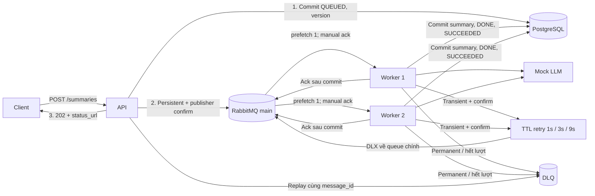

# Thiết kế và giới hạn

## Luồng chính

## Tám quy tắc của bài học

1. Queue durable, message persistent, chờ confirm trước 202. `mandatory=true` phát hiện routing thất bại. Confirm có timeout 3 giây; AMQP connect có timeout. Mỗi publish dùng confirm channel riêng để không lẫn callback/return của các request đồng thời.
2. `noAck=false`, commit kết quả và job DONE rồi mới ack. Broker giao lại unacked khi channel/process mất.
3. Advisory lock PostgreSQL theo `job_id` bao quanh một lần xử lý, kể cả lời gọi mock. Khi SIGKILL, DB tự giải phóng lock. Nhận lại job DONE: ghi DUPLICATE, ack, không gọi mock. `UNIQUE(summaries.job_id)` là hàng rào cuối; cờ redelivered chỉ là bằng chứng giao lại, không quyết định nghiệp vụ.
4. Lỗi transient được publish confirmed vào retry queue riêng TTL 1000/3000/9000 ms rồi mới ack message nguồn. TTL hết, DLX đưa về main. Không dùng sleep trong RAM để retry nghiệp vụ, không nack requeue ngay cho 429/503.
5. Lỗi vĩnh viễn như NO_AUDIO đi DLQ ngay. 429/5xx/network/timeout là transient; HTTP 4xx khác là permanent. Quyết định bằng status/error_type. Tối đa 4 attempts trong một replay generation, số đếm truy vấn từ DB. Tổng attempt_no của message luôn tăng, kể cả sau replay. CRASHED cũng tính là một lần xử lý.
6. DLQ lưu envelope nguyên và headers error_type, attempt_count, correlation_id. Replay scan bằng basic.get/manual ack, giữ các message không khớp unacked rồi đóng channel để requeue; serialize scan bằng advisory lock. Bản lab scan O(n), phù hợp queue nhỏ; hệ thống lớn cần chỉ mục/quy trình vận hành khác. `replay_events` lưu generation/thời điểm; không thay message_id.
7. Hai consumer cùng main queue, prefetch=1. Mỗi process xử lý một delivery tại một thời điểm, broker phân phối công việc. Hai job khác nhau có thể gọi mock đồng thời.
8. Version cấp bằng `UPDATE videos SET next_version=next_version+1 RETURNING` trong cùng transaction tạo job. Khi commit: `UPDATE videos ... WHERE current_version < new_version`. Cả hai summary được lưu, bản hiện tại không lùi version khi job cũ xong sau.

## Mô hình dữ liệu

`videos` chứa transcript seed (đại diện video đã upload), has_audio, version counter và con trỏ bản hiện tại. `jobs` chứa yêu cầu và replay_count. `summaries` UNIQUE(job_id). `processing_attempts` ghi `message_id`, số thứ tự, generation, worker_id, redelivered, started_at, finished_at, outcome và error_type.

Outcome `NULL` nghĩa là **đang xử lý**, không phải kết quả cuối thứ sáu. Khi delivery tiếp theo giành được job lock, attempt dở được đóng thành CRASHED. Không suy diễn process chết chỉ từ timeout. Bằng chứng tại thời điểm process đang tắt vẫn có attempt outcome NULL; snapshot sau recovery mới có CRASHED. F5 khác: SUCCEEDED đã commit nên không đổi thành CRASHED.

`mock_calls` ghi durable trước khi trả response; do đó worker crash/HTTP timeout không làm mất bộ đếm. Mock delay mặc định 400 ms; cấu hình status 429/503, fail_first, timeout, delay_ms. Timeout worker 1500 ms, fault timeout của mock phản hồi sau 2500 ms. Không có API key/SDK LLM thật.

Message `SummarizeVideo`: message_id, job_id, video_id, version, correlation_id, created_at, options. Không chứa binary/video/transcript. Metadata message AMQP cũng có messageId/correlationId/type/contentType.

## Ba khoảng hở và phạm vi cam kết

**Gap 1 — DB commit, chưa publish:** API chết hoặc broker không nhận sau khi đã ghi QUEUED. F6 cố ý giữ lại orphan: 503, QUEUED, không attempt, không message. Không thêm outbox/retry RAM để giấu ca này; outbox thuộc block sau. 503/confirm timeout cũng có thể là kết quả không rõ ràng: broker có thể đã nhận nhưng xác nhận không tới; client gửi lại có thể tạo job mới. Chưa có HTTP idempotency key.

**Gap 2 — DEAD_LETTERED commit, chưa đưa DLQ:** nếu unacked delivery được giao lại, worker thấy DEAD_LETTERED và xuất lại DLQ rồi ack. Không có transaction nguyên tử giữa DB và RabbitMQ. Crash sau publish confirmed nhưng trước ack có thể tạo hai bản message (kể cả retry/DLQ/replay); việc nghiệp vụ vẫn dùng DB idempotency, nhưng broker không hứa exactly-once. Replay không phải transaction phân tán: crash quanh publish/commit có thể để lại message trùng hoặc DLQ chưa ack. Lab không tuyên bố xóa mọi bản trùng vật lý trong các cửa sổ này.

**Gap 3 — LLM thành công, trước DB commit:** F8 tạo hai lần gọi mock nhưng chỉ một summary. UNIQUE(job_id) không hủy được lời gọi bên ngoài đã xảy ra. Không tuyên bố exactly-once cho LLM.

Retry dùng classic durable queues và TTL/DLX. RabbitMQ DLX mặc định có cửa sổ mất message nếu đích không nhận được; một node/volume không thay thế HA/quorum hoặc backup. F6 kiểm chứng restart broker với dữ liệu còn trên cùng volume, không chứng minh chịu được mất disk. Triển khai thực cần quorum + at-least-once dead lettering và outbox/inbox tùy phạm vi. Chỉ số đo thực trong `evidence/` được dùng làm kết luận lab.

## Tổ chức phiên bản

APP_VERSION=V0 chọn xử lý đồng bộ trên API. V1 có queue, idempotency, version; lỗi được đóng vào DLQ để không kẹt, chưa retry. V2 bật retry/replay. V3 bật checkpoint pause. Dùng chung module để phần cải tiến dễ đối chiếu, không nhân bản bốn thư mục source. LAB_MODE trong Compose cho phép cấu hình mock; ngoài lab, options fault/pause bị chặn, route sửa fault trả 404.
