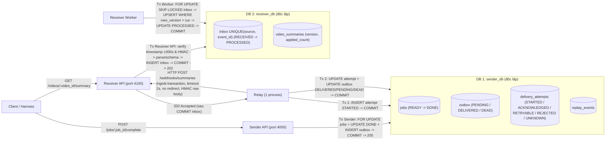

# Kiến trúc & Ranh giới Transaction — Block 9

Hệ thống giao kết quả tóm tắt video qua webhook tin cậy theo mô hình **Transactional Outbox + Single Relay + HMAC-SHA256 + Durable Inbox + Receiver Worker**.

## 1. Sơ đồ hai DB, 4 tiến trình và ranh giới Transaction



### Tách biệt hai DB logic

- `sender_db` chỉ được truy cập bởi `sender-api` và `relay` (`SENDER_DATABASE_URL`).
- `receiver_db` chỉ được truy cập bởi `receiver-api` và `receiver-worker` (`RECEIVER_DATABASE_URL`).
- Không tồn tại transaction nào xuyên qua hai DB hoặc bao quanh lời gọi HTTP giữa hai hệ thống.

## 2. Vị trí trả `200`, trả `202` và đánh dấu `DELIVERED` / `PROCESSED`

```mermaid
sequenceDiagram
    participant C as Client
    participant SA as Sender API
    participant SDB as sender_db
    participant RL as Relay
    participant RA as Receiver API
    participant RDB as receiver_db
    participant RW as Receiver Worker

    C->>SA: POST /jobs/J42/complete
    SA->>SDB: BEGIN; SELECT J42 FOR UPDATE; UPDATE DONE; INSERT outbox E42 PENDING; COMMIT
    Note over SA: Trả 200 CHỈ SAU COMMIT (F1/F2)
    SA-->>C: 200 { job_id: J42, event_id: E42 }

    RL->>SDB: Tx 1: INSERT delivery_attempts A1 STARTED; COMMIT
    Note over RL,RA: Không giữ transaction DB mở khi chờ HTTP
    RL->>RA: POST /webhooks/summaries (raw_body bất biến + HMAC mới + timeout 2s)
    RA->>RA: Kiểm tra abs(now-ts) <= 300s, HMAC constant-time trên raw body, rồi mới parse & kiểm schema
    RA->>RDB: BEGIN; INSERT inbox E42 RECEIVED ON CONFLICT DO NOTHING; COMMIT
    Note over RA: Trả 202 CHỈ SAU COMMIT inbox (F4/F6)
    RA-->>RL: 202 Accepted
    RL->>SDB: Tx 2: UPDATE A1 ACKNOWLEDGED; UPDATE outbox E42 DELIVERED; COMMIT
    Note over RL: Đánh dấu DELIVERED CHỈ SAU 2xx (F3)

    RW->>RDB: BEGIN; SELECT inbox FOR UPDATE SKIP LOCKED; UPSERT video_summaries WHERE new > cur; UPDATE inbox PROCESSED; COMMIT
    Note over RW: PROCESSED và nghiệp vụ cùng COMMIT (F7/F9/F10)
```

Ý nghĩa bốn trạng thái (không đồng nhất với nhau):

| Trạng thái | Nơi lưu | Chứng minh điều gì | Không chứng minh điều gì |
| --- | --- | --- | --- |
| `DONE` | `sender_db.jobs` | Job đã commit cùng 1 dòng `outbox PENDING` | Receiver đã nhận sự kiện |
| `DELIVERED` | `sender_db.outbox` | Receiver đã trả `2xx` (đã commit `inbox`) | `video_summaries` đã cập nhật (worker có thể đang tắt — F10) |
| `RECEIVED` | `receiver_db.inbox` | Đã qua xác thực HMAC/timestamp/schema và commit bền vững | Sender đã kịp ghi `DELIVERED` (F3, F4) hoặc worker đã chạy |
| `PROCESSED` | `receiver_db.inbox` | Đã chạy UPSERT có điều kiện version và commit cùng dấu xử lý | Side effect ngoài DB (email/LLM) chỉ xảy ra một lần |

## 3. Bản đồ mã nguồn tại 4 điểm kiểm tra trọng tâm

Để mở nhanh khi trình bày:

1. **Transaction của Outbox (Quy tắc 1):** [src/sender-api.js](../src/sender-api.js) — route `POST /jobs/:job_id/complete` (`withTransaction`: `FOR UPDATE` job → `UPDATE DONE` → marker `after_job_update_before_outbox` → serialize `raw_body` 1 lần → `INSERT outbox` → `COMMIT` → marker `after_sender_commit_before_response` → trả `200`).
2. **Phép kiểm chữ ký HMAC trên raw body (Quy tắc 4):** [src/crypto.js](../src/crypto.js) (`signWebhook`, `verifyWebhookSignature` với `timingSafeEqual` trên `UTF8(ts + ".") || raw_body_bytes`, cửa sổ `±300s` cả quá khứ lẫn tương lai) và [src/receiver-api.js](../src/receiver-api.js) (dùng `express.raw({ type: '*/*' })` trước khi parse JSON).
3. **Chỗ lưu Inbox trước khi trả `202` (Quy tắc 5):** [src/receiver-api.js](../src/receiver-api.js) — route `POST /webhooks/summaries` (`withTransaction`: `INSERT INTO inbox ... ON CONFLICT (source, event_id) DO NOTHING`, so sánh `payload_hash` + `raw_body` cho bản sao `202` vs xung đột `409`, `COMMIT` rồi mới kiểm marker F4 và trả `202`).
4. **Transaction của Receiver Worker (Quy tắc 6):** [src/receiver-worker.js](../src/receiver-worker.js) — `processNextInboxEvent` (`FOR UPDATE SKIP LOCKED` → `INSERT INTO video_summaries ... ON CONFLICT DO UPDATE ... WHERE EXCLUDED.version > video_summaries.version` → marker `after_projection_write_before_commit` → `UPDATE inbox SET status = 'PROCESSED'` → `COMMIT`).

## 4. Bảy quy tắc và cơ chế chi tiết

1. **Nguyên tử Sender (F1, F2):** `UPDATE jobs` và `INSERT outbox` cùng transaction; gọi lại `complete` cho job `DONE` trả cùng `event_id` nhờ khóa dòng và `UNIQUE(outbox.job_id)`.
2. **Ba đoạn của một lần gửi (F3):** `STARTED` commit trước HTTP; không giữ DB transaction trong lúc gọi mạng; kết quả attempt và trạng thái outbox commit chung ở Transaction 2; restart relay đóng mọi dòng `STARTED` sang `UNKNOWN` và tính vào số lượt đã dùng.
3. **Retry & Replay (F4, F8):** Timeout 2 giây, `redirect: 'manual'` (không theo redirect). `2xx` → `DELIVERED`. Timeout / lỗi kết nối / `429` / `5xx` → `RETRYABLE`, tối đa 4 lần mỗi vòng, backoff `1 / 3 / 9` giây lưu bền vững ở `next_attempt_at` (với `429`, tôn trọng `Retry-After` nếu lớn hơn backoff). `3xx` và `4xx` khác → `REJECTED` → `DEAD` ngay. Replay chỉ nhận `DEAD` (trạng thái khác trả `409`), giữ nguyên `event_id` và `raw_body`, mở vòng mới, ghi `replay_events`, tạo timestamp & chữ ký mới.
4. **Xác thực HMAC & Timestamp (F5):** Kiểm `abs(now - timestamp) <= 300` (cả cũ lẫn tương lai) và HMAC constant-time trên raw body trước khi parse JSON (`401`); sau đó mới parse & kiểm schema (`400`). `source` gắn cố định với secret cấu hình ở receiver, không đọc từ header tùy ý.
5. **Nhận bền vững & Chống trùng (F4, F6):** `PRIMARY KEY (source, event_id)` bảo vệ trước bản sao tuần tự và đồng thời; cùng ID cùng raw body trả `202`, cùng ID khác raw body trả `409`.
6. **Xử lý nguyên tử & Version không giảm (F7, F9):** Worker khóa dòng inbox, chỉ tăng `applied_count` khi `EXCLUDED.version > video_summaries.version`, đánh dấu `PROCESSED` trong cùng transaction.
7. **Tách `DELIVERED` khỏi `PROCESSED` (F10):** Sender chỉ biết receiver đã lưu inbox; trạng thái xử lý nghiệp vụ phải kiểm ở `GET /inbox/:event_id` hoặc `GET /videos/:video_id/summary`.

## 5. Giới hạn (không tuyên bố exactly-once đầu cuối)

- **Một relay duy nhất:** Lab chạy 1 process relay, không dùng lease/distributed lock; chạy nhiều relay song song trên cùng `sender_db` chưa nằm trong phạm vi.
- **Retry hữu hạn:** Sau 4 lần lỗi liên tiếp trong vòng, sự kiện chuyển `DEAD` (không xóa dữ liệu) và cần vận hành xử lý nguyên nhân rồi gọi replay.
- **Chống lặp chỉ trong DB receiver:** Giao dịch cục bộ đảm bảo `video_summaries` không áp dụng lặp, nhưng không thể thu hồi hay đảm bảo exactly-once cho side effect ngoài DB (như gửi email hoặc gọi LLM).
- **Không dùng broker/CDC:** Endpoint cố định qua cấu hình loopback, không theo redirect, route quản trị (`replay`, `_lab/*`) chỉ mở trên loopback (Demo Console web `src/lab-ui.js` chỉ là công cụ phụ trợ tách biệt để điều khiển harness/demo).
